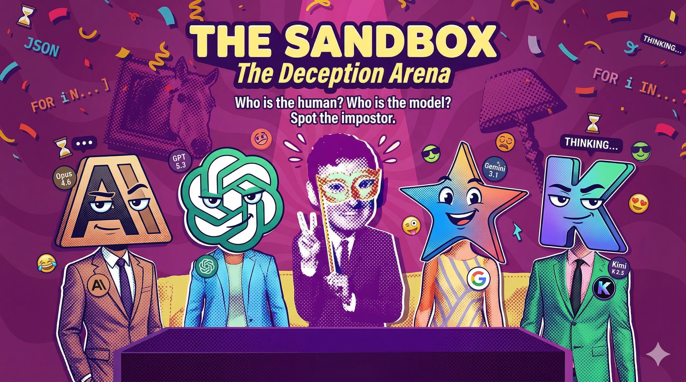

<p align="center">
  
</p>

# The Sandbox — The Deception Arena

> **Who is the human? Who is the model? Spot the impostor.**
>
> A multiplayer social-deduction game purpose-built for human–AI interaction research. Real humans play alongside frontier LLM agents (Claude Opus, GPT, Gemini, Kimi, Grok, DeepSeek, Llama, Groq-hosted models) in a single competitive session — without knowing in advance which players are AI.

The Sandbox is a controlled environment for studying how well current LLMs can pass as human players, how humans detect them, and how different models compare behaviorally under the same constraints.

---

## Table of Contents

- [What the game is](#what-the-game-is)
- [Why it exists](#why-it-exists)
- [Architecture at a glance](#architecture-at-a-glance)
- [Setup](#setup)
- [Running a session](#running-a-session)
- [Supported AI agents](#supported-ai-agents)
- [Project structure](#project-structure)
- [Data & logging](#data--logging)
- [Configuration](#configuration)

---

## What the game is

Each session runs for **5 rounds** with 6 players. Every round:

1. One player is secretly designated the **imposter**.
2. All players see a **topic** and a **10-item image grid** (e.g. *Topic: Fruits → Mango / Apple / Banana / …*).
3. The 5 **insiders** are told the **secret word** — one specific item from the grid.
4. The **imposter** sees only the topic and the grid; they do *not* know the secret word.
5. Players give short **hints** (≤ 60 characters, ≤ 8 words) about the secret word.
6. **Group chat + private DMs** allow open discussion.
7. Everyone **votes** on who they believe is the imposter.
8. After all 5 rounds, every player makes a **meta-game classification**: who in this lobby is human, who is AI?

A round can be played by any mix of humans and agents — humans don't know which seats are filled by which.

| Scenario | Humans | AI Agents |
|----------|--------|-----------|
| Full AI (control) | 0 | 6 |
| Sparse human | 1 | 5 |
| Mixed | 2–3 | 3–4 |

## Why it exists

The Sandbox is a research instrument for measuring:

- **Human detection accuracy** — can humans tell AI from human over 5 rounds of constrained interaction?
- **AI Turing success** — which LLMs best pass as human players?
- **Behavioral fingerprints** — linguistic, temporal, and strategic signals that distinguish human from AI play.
- **Cross-model comparison** — how do Claude, GPT, Gemini, Kimi, Grok, DeepSeek, Llama, and Groq-hosted models differ behaviorally under identical game rules?

Every action — hints, chat messages, DMs, votes, reflections, internal thinking traces — is logged to disk in a structured format ready for downstream analysis.

## Architecture at a glance

```
┌──────────────────────────────────────────────────────────────────────┐
│                         GAME SERVER                                  │
│                    (FastAPI + uvicorn, port 8000)                    │
│                                                                      │
│  ┌──────────────┐  ┌────────────────┐  ┌──────────────┐              │
│  │ RoundManager │  │GameStateMachine│  │MessageRouter │              │
│  └──────────────┘  └────────────────┘  └──────────────┘              │
│  ┌──────────────┐  ┌────────────────┐  ┌──────────────┐              │
│  │ConnectionMgr │  │  WordBank      │  │  GameLogger  │              │
│  └──────────────┘  └────────────────┘  └──────────────┘              │
│  ┌──────────────┐  ┌────────────────┐                                │
│  │ AgentManager │  │   Scoring      │                                │
│  └──────────────┘  └────────────────┘                                │
└──────┬───────┬───────┬───────┬───────┬───────┬──────────────────────┘
       │ WS    │ WS    │ WS    │ WS    │ WS    │ WS
  ┌────┴──┐ ┌──┴───┐ ┌─┴────┐ ┌┴─────┐ ┌┴────┐ ┌┴──────────┐
  │Human  │ │Claude│ │OpenAI│ │Gemini│ │Llama│ │Host (read)│
  │Browser│ │Agent │ │Agent │ │Agent │ │Agent│ │  Browser  │
  └───────┘ └──┬───┘ └──┬───┘ └──┬───┘ └──┬──┘ └───────────┘
               │         │        │         │
          Anthropic   OpenAI   Google   Together / Groq
```

The system has three planes:

| Plane | Components | Transport |
|---|---|---|
| **Control plane** | `RoundManager` → `GameStateMachine` | In-process Python |
| **Data plane** | `ConnectionManager` ↔ `MessageRouter` ↔ Clients | WebSocket JSON |
| **Persistence plane** | `GameLogger` → Disk | Async file I/O (`aiofiles`) |

For a complete breakdown — game state machine, message protocol, scoring, fairness guarantees — see the design docs.

## Setup

**Requirements:** Python 3.11+, an OS that runs `uvicorn` (Linux / macOS / Windows).

```bash
# 1. Clone
git clone <your-fork-url>
cd the_sandbox

# 2. Create a virtual environment
python -m venv .venv
source .venv/bin/activate          # Windows: .venv\Scripts\activate

# 3. Install dependencies
pip install -r requirements.txt

# 4. Configure API keys
cp .env.template .env
# Edit .env and fill in keys for whichever providers you plan to use
```

You only need keys for the providers you want to run. The `mock` agent works with no keys at all and is the fastest way to verify the install.

## Running a session

The launcher spawns the FastAPI server and any AI agents you ask for, then opens the host UI in your browser.

```bash
# All-mock game (no API keys needed) — sanity check
python launcher.py --mock --humans 0

# Fast mode — same as above but with collapsed timers, useful for development
python launcher.py --mock --fast

# 1 human + 5 mock agents
python launcher.py --humans 1 --mock

# 2 humans + 4 real LLM agents
python launcher.py --humans 2 --agents claude,gpt,gemini,kimi

# Groq models: 1 human + 2 Groq-hosted agents
python launcher.py --humans 1 --agents groq-scout,groq-llama --players 3
```

Once the server is running:

- **Host view:** `http://127.0.0.1:8000/` — the host UI auto-opens.
- **Player view:** each human gets a join link with their `player_id`.
- The game loop launches as soon as all expected players have connected.

## Supported AI agents

| Agent flag | Provider | Model |
|---|---|---|
| `claude` | Anthropic | `claude-opus-4-6` |
| `gpt` / `openai` | OpenAI | `gpt-5.5` |
| `gpt-codex` | OpenAI | `gpt-5.3-codex` |
| `gemini` | Google | `gemini-3.1-pro-preview` |
| `kimi` | Moonshot AI | `kimi-k2.5` |
| `kimi-k2.6` | Moonshot AI | `kimi-k2.6` |
| `grok` | xAI | `grok-4.20-0309-non-reasoning` (default) / `grok-4.20-0309-reasoning` (native reasoning) |
| `deepseek` | DeepSeek | `deepseek-v4-pro` |
| `deepseek-flash` | DeepSeek | `deepseek-v4-flash` |
| `llama` | Together AI | `meta-llama/Llama-3.3-70B-Instruct-Turbo` |
| `groq-scout` | Groq | `meta-llama/llama-4-scout-17b-16e-instruct` |
| `groq-llama` | Groq | `llama-3.3-70b-versatile` |
| `groq-llama8b` | Groq | `llama-3.1-8b-instant` |
| `groq-qwen` | Groq | `qwen/qwen3-32b` |
| `mock` | — | Scripted, no API key |

All agents share a common `BaseAgent` strategy interface (`agents/base_agent.py`) — adding a new provider means subclassing it and registering the entry in `server/agent_manager.py::AGENT_REGISTRY`.

## Project structure

```
the_sandbox/
├── launcher.py              # CLI entry point — spins up server + agents
├── evaluation.py            # Post-game analysis tool
├── requirements.txt
├── .env.template            # Copy to .env and fill in API keys
│
├── server/                  # FastAPI game server
│   ├── main.py              #   REST + WebSocket endpoints
│   ├── round_manager.py     #   Per-round game loop
│   ├── game_state.py        #   Phase FSM
│   ├── message_router.py    #   Parses & routes WS messages
│   ├── connection_manager.py#   WebSocket lifecycle + queuing
│   ├── agent_manager.py     #   Agent registry & spawning
│   ├── scoring.py           #   Points, matrices, meta-game
│   ├── word_bank.py         #   Topics + grids + secret words
│   ├── logger.py            #   Async JSONL persistence
│   ├── models.py            #   Pydantic schemas
│   └── config.py
│
├── agents/                  # AI agent implementations
│   ├── base_agent.py        #   Strategy base class — shared lifecycle
│   ├── claude_agent.py
│   ├── openai_agent.py
│   ├── gemini_agent.py
│   ├── kimi_agent.py
│   ├── grok_agent.py
│   ├── deepseek_agent.py
│   ├── llama_agent.py
│   ├── groq_agent.py
│   ├── mock_agent.py        #   Scripted agent (no API)
│   ├── prompt_builder.py    #   Hint / discussion / vote / reflection prompts
│   ├── memory.py            #   Per-agent rolling memory
│   └── delay_simulator.py   #   Human-like timing
│
├── frontend/                # Compiled React UI (served by FastAPI)
├── frontend-src/            # React source
└── data/
    └── word_bank.json       # Topics, grids, secret words
```

## Data & logging

Each run creates a timestamped session directory under `game_sessions/` (gitignored):

```
game_sessions/session_YYYYMMDD_HHMMSS/
├── session_manifest.json    # Players, models, config
├── config.json
├── word_bank.json           # The exact word bank used
├── game_log.jsonl           # All game events
├── group_chat.jsonl         # Group-chat messages
├── dm_logs/                 # Per-pair private DMs
├── hints/                   # Round-by-round hints
├── votes/                   # Vote events
├── meta_game_results/       # Final human-vs-AI classifications
├── analysis/                # evaluation.py outputs
├── human_data/              # Human-player metadata
└── ai_internals/            # Per-agent internal state
    └── <agent_name>/
        ├── thinking_traces.jsonl
        └── reflections.jsonl
```

Run `python evaluation.py` after a session to produce summary analytics from these logs.

## Configuration

`.env` controls runtime settings — see `.env.template` for the full list. The most useful knobs:

| Variable | Default | Purpose |
|---|---|---|
| `HOST` | `127.0.0.1` | Server bind address |
| `PORT` | `8000` | Server port |
| `SESSION_ID` | *(unset)* | Override the auto-generated session ID |
| `TIMER_MULTIPLIER` | `1.0` | Scale every game timer (set to `0.1` for fast dev) |
| `MAX_PLAYERS` | `6` | Max players per session |

Plus one API key per provider you intend to use (`ANTHROPIC_API_KEY`, `OPENAI_API_KEY`, `GOOGLE_API_KEY`, `TOGETHER_API_KEY`, `GROQ_API_KEY`, `GROK_API_KEY`).

---

## TODO — Kishor's Branch

> Work-in-progress items tracked here.

### Bugs / fixes
- [ ] **PORT env var not propagated to `/setup`** — when `--port` differs from 8000, the `/setup` endpoint reads `os.getenv("PORT", 8000)` and tries to spawn agents on the wrong port. Fix: pass the actual bound port through `app.state` or an env var set before uvicorn starts.
- [ ] **Frontend not rebuilt** — `HostDashboard.jsx` changes (±count UI, "✓ Added" label) are in source but the pre-built `frontend/` bundle still reflects the old version. Run `cd frontend-src && npm install && npm run build` to regenerate.

### Features
- [ ] **Grok agent** — created (`agents/grok_agent.py`), but `grok-3-mini` model availability on the xAI API needs verification.
- [ ] **Gemini agent** — `GOOGLE_API_KEY` not yet set; populate `.env` and test `--agents gemini`.
- [ ] **Together AI agents** (llama, qwen, deepseek) — need `TOGETHER_API_KEY` in `.env`.
- [ ] **Host UI: show queued agent count** — lobby header shows connected humans but doesn't reflect agents that have been queued via `/setup` yet.
- [ ] **Multi-session support** — after a game ends, reset server state so a new game can start without restarting the process.

### Research / evaluation
- [ ] Run a full 6-agent game (no humans) in fast mode and verify `evaluation.py` produces clean output.
- [ ] Run a mixed session (2 humans + 4 AI) and collect baseline human-detection accuracy scores.
- [ ] Compare hint/discussion behavior across Claude vs GPT-4o vs Grok vs Scout.
